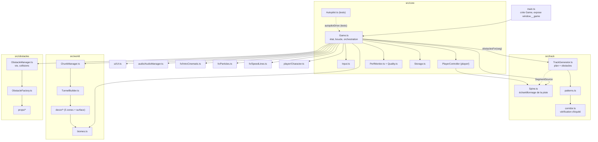
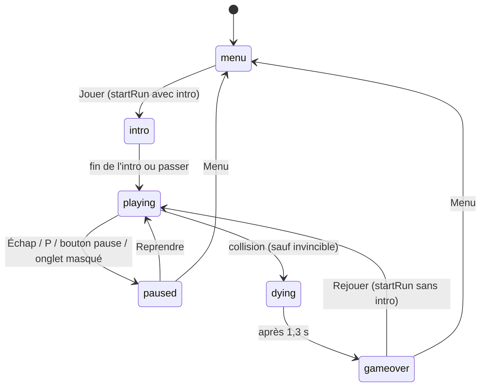

# Architecture technique — Drain Rifter

Document destiné aux développeurs. Il décrit le fonctionnement réel du code (valeurs issues de `src/core/config.ts` et des modules). Pour les règles de collaboration et la répartition des fichiers, voir `AGENTS.md`. Les contrats partagés sont dans `src/core/types.ts`, et chaque module important porte un commentaire `CONTRACT` en tête.

## 1. Vue d'ensemble des modules



Le moteur de rendu est Three.js 0.170. Le HUD, les menus et les paramètres sont du DOM (`#ui`) superposé au canvas (`#game`). Le son est entièrement synthétisé avec Web Audio, sans fichiers audio.

## 2. Espace de piste (s, u)

Toute la logique de jeu est exprimée dans un repère de piste, pas dans le monde 3D.

- **s** : distance le long de la colonne vertébrale (spine), en mètres, monotone et partant de 0.
- **u** : décalage latéral par rapport à l'axe, en mètres. Positif = droite du joueur.
- La surface est un demi-tube : la hauteur au-dessus de l'axe, à décalage u, est `profileHeight(u, largeur)`.

Repère local des objets (obstacles, personnage) : +x = droite de la piste, +y = normale de la surface, -z = avant. Les maillages gardent une géométrie locale, positionnée à l'origine de leur chunk ou de leur obstacle. Cela préserve la précision des float32 sur de très longues distances.

Le joueur n'a qu'un degré de liberté contrôlé (u). Sa position le long de la piste (s) avance à `speedAt(s)`.

## 3. Colonne vertébrale (`track/Spine.ts`) et profil en demi-tube

**Échantillonnage.** La spine est une courbe 3D échantillonnée tous les 1 m (`CONFIG.spine.step`). Elle est intégrée à partir du plan de segments : à chaque mètre, le cap (yaw), la pente (pitch), le roulis (roll) et la largeur convergent vers les cibles du segment courant par lissage exponentiel (constante de 14 m pour le cap et la pente, 20 m pour la largeur). Le roulis d'un segment vaut `clamp(-yaw × 6,5, ±0,22)`.

**Échantillonnage à la demande.** `frame(s, out)` interpole linéairement entre deux échantillons et retourne position, repère (fwd, right, up), largeur, biome courant, biome suivant et facteur de fondu. `ensure(s)` génère la piste jusqu'à `s`. `trim(s)` supprime les échantillons et segments devenus inutiles.

**Profil en demi-tube** (`profileHeight`, `profileSlope`, `usableHalfWidth`) :

- Plat central : `|u| ≤ 0,45 × W/2` (`track.flatFraction`). Hauteur nulle.
- Au-delà, un arc de cercle de rayon `r = W/2 − plat` remonte la paroi.
- Au-delà de `W/2`, la paroi continue de monter plus raidement.
- Limite jouable : `|u| ≤ 0,9 × W/2` (`track.usableFraction`).

Largeurs : défaut 9 m, bornes 7 à 13 m (`CONFIG.track`).

## 4. Plan de piste et générateur procédural (`track/TrackGenerator.ts`)

Le générateur est déterministe pour une graine donnée (`RNG` mulberry32, deux flux séparés : plan et obstacles). Il implémente `SegmentSource` pour la spine.

**Blocs de biome.** Chaque biome occupe un bloc de 700 m (`CONFIG.biome.length`) : environ 610 m de motifs, puis un segment de transition de 90 m (`toBiome`). Les 150 premiers mètres sont une ligne droite sans obstacle (`INTRO`).

**Motifs.** Chaque motif produit un ou plusieurs segments : `straight`, `sbend`, `sweep`, `chicane`, `drop` (pente forte), `squeeze` (couloir étroit, 7,0 à 7,8 m), `hall` (grande salle, 12 m et plus). Les poids dépendent du biome (table `STYLE`). Un motif répété est pénalisé ×0,3.

**Cycles.** Le premier cycle suit l'ordre canonique (égouts, industrie, cavernes, ruines, abîme). Les cycles suivants commencent par les égouts, puis mélangent les quatre autres de façon déterministe. La difficulté d'un cycle `c` est renforcée : motifs plus serrés, plus de lacets, pentes plus fortes (`hard = min(c, 3)`).

**Difficulté** (`core/difficulty.ts`) :

- `difficultyAt(d) = 1 − exp(−max(0, d − 250) / 3400)` : nulle jusqu'à 250 m, proche de 1 après plusieurs kilomètres.
- `speedAt(d) = 15 + 30 × (1 − exp(−d / 3000))` m/s : 15 m/s au départ, tend vers 45 m/s.

## 5. Obstacles : génération et équité

### 5.1 Patrons (`track/patterns.ts`)

Un patron est une fonction qui produit une liste d'`ObstacleSpec` à partir d'un contexte (RNG, s, difficulté `d`, cycle, largeurs, intervalles atteignables). Les patrons :

| Patron | Difficulté minimale | Principe |
|---|---|---|
| `single` | 0 | Un bloc collé à une paroi |
| `center` | 0 | Un bloc près du centre, à gauche ou à droite |
| `gate` | 0,04 | Rangée pleine avec une ouverture |
| `twoGap` | 0,10 | Rangée avec deux ouvertures et un bloc central |
| `slalom` | 0,12 | Portes alternées gauche / droite |
| `funnel` | 0,20 | Ouverture qui se rétrécit rangée après rangée |
| `stagger` | 0,25 | Demi-rangées qui forcent des zigzags |
| `moving` | 0,12 | Obstacle mobile (glisseur ou balancier), voie libre permanente |
| `fallingGate` | 0,10 | Débris qui tombent devant le joueur |
| `collapse` | 0,30 | Amas de débris sur 2 à 3 rangées |

**Ouverture cible.** Chaque patron vise un écart libre `g = 2,4 − 1,05 × d` m (entre 2,4 m au début et 1,35 m à la difficulté maximale). `d` ajoute `0,07 × min(cycle, 4)` à la difficulté de base, plafonnée à 1.

**Types par biome** (`BASE_KINDS` et `CYCLE_DYN`) :

| Biome | Barres (`span`) | Blocs (`solid`) | Dynamiques (`dyn`) |
|---|---|---|---|
| Égouts | barrier, grate | crate, pipe, debris | aucun (falling après le cycle 0) |
| Industrie | beam, barrier | piston, fan, crate | slider (+ falling, swinger) |
| Cavernes | root | rock, stalagmite, boulder | falling (+ swinger) |
| Ruines | aucun | pillar, statue, rubble | swinger, falling (+ slider) |
| Abîme | aucun | crystal, shard, orb | slider, swinger (+ falling) |

Quand un biome n'a pas de `span`, le patron `gate` utilise les types `solid`.

### 5.2 Cadence

Après chaque patron validé, le curseur avance de `vitesse × dt`, avec `dt = 2,5 − 1,8 × d + U(0 ; 0,45)` s. Avec une probabilité `0,12 + 0,25 × d`, l'intervalle est raccourci (×0,55, minimum 0,7 s).

**Zones calmes** : les 165 premiers mètres, les 30 derniers mètres de chaque bloc et les 60 premiers mètres de chaque bloc (sauf le premier) ne reçoivent aucun obstacle.

### 5.3 Vérification d'équité (`track/corridor.ts`)

Chaque patron candidat est simulé avant d'être accepté (`advanceCorridor`) :

- Le joueur est modélisé par l'ensemble des positions latérales atteignables (`R`, une union d'intervalles).
- Un obstacle bloque l'intervalle `[u − hw − amp − r, u + hw + amp + r]` sur sa fenêtre en s (`depth/2 + r`). Les obstacles mobiles bloquent toute leur plage de balayage.
- La vitesse latérale de référence est 6 m/s (`vLat`) ; un temps de réaction de 0,25 s est déduit à chaque tronçon libre.
- Un tronçon libre trop étroit (écart minimal `g`) est écarté.
- Si `R` devient vide, le patron est rejeté. Jusqu'à 10 essais par position ; sinon, le curseur avance de 25 m.

**Chute des débris** : le débris tombe sur 0,9 s, mais n'a de collision qu'à partir de 85 % de sa chute (0,765 s). Il doit atterrir au moins 0,8 s avant l'arrivée du joueur (`FALL_MIN_LEAD`). Son déclenchement est à `ceil(vitesse × 1,9 + 4)` m devant le joueur.

Les tests (`tests/generator.fairness.test.ts`) valident la piste sur plusieurs graines (`validateLayout`) et font jouer un robot sur 20 km.

## 6. Streaming des chunks et disposition (`world/`)

**`ChunkManager`** construit des tronçons de tunnel de 24 m (`CONFIG.chunk.length`) devant le joueur :

- Portée : `min(260, viewDistance + 30)` m devant le joueur.
- Les 60 premiers mètres sont toujours construits. Au-delà, la construction est limitée à 2 chunks par image et à 3 ms de temps de calcul.
- `update(s, 100)` construit tout de façon synchrone (pré-construction, téléportation de test).
- Les chunks dont la fin est plus de 40 m derrière le joueur sont supprimés. `disposeObject` libère les géométries et matériaux, sauf ceux marqués `userData.shared`.
- Chaque chunk peut définir `userData.update(dt, time)`, appelé chaque image.

**`TunnelBuilder.buildTunnelChunk`** construit un chunk en deux passes :

1. Passe « émetteurs de lumière » sur le chunk et 9 m de chaque côté (`SPILL`), pour que les halos ne s'arrêtent pas aux bords.
2. Passe « décor réel » sur le chunk, puis `buildSurface` (sol et parois), teintés par les émetteurs.

La qualité (`low`, `medium`, `high`) règle la finesse du décor : pas de 3 m, 2 m ou 1,5 m le long de s pour la surface.

**Décor par zone** (`world/decor/*.ts`, un fichier par zone) : égouts (conduits, lampes en cage, grilles), industrie (nervures, poutres, ventilateurs), cavernes (cristaux), ruines (colonnes, arches, statues, runes), abîme (îles, anneaux impossibles, cristaux géants, brume). `ctx.ts` fournit le contexte de chunk (repère de la piste, profils de paroi), `kit.ts` construit les maillages (`Buf`, `ChunkKit`) et les émetteurs.

**Couleurs** : `world/biomes.ts` définit une `BiomeLook` par zone (brouillard, lumières, sol, mur, accent). `blendColor` et `blendNumber` interpolent entre la zone courante et la suivante pendant une transition.

## 7. Cycle de vie des obstacles et collisions (`obstacles/`)

**Cycle de vie** :

1. **En attente** : `Game.feedObstacles` ajoute, pour chaque nouveau segment, les `ObstacleSpec` produits par le générateur (`obstaclesFor`). Les specs sont triées par s.
2. **Actif** : quand `spec.s < joueur.s + viewDistance`, `ObstacleManager` appelle `createObstacleMesh(spec)` puis ajoute l'obstacle à la liste active.
3. **Animation** : chaque image, les obstacles mobiles reçoivent leur décalage latéral (`slide` ou `swing`, sinusoïde de période `period`) ; les débris progressent dans leur chute (`fall`).
4. **Retrait** : un obstacle dont `spec.s < joueur.s − 20` est retiré de la scène et libéré.

**Types de mouvement** (`ObstacleSpec.motion`) : `slide` (glissement latéral), `swing` (balancement, même traitement), `fall` (chute déclenchée à `triggerAhead`).

**Modèles 3D** (`ObstacleFactory.ts`) : une table `BUILDERS` associe chaque type à un constructeur de `props/`. Les constructeurs construisent dans le repère local. Les parties statiques sont fusionnées par matériau (`mergeStatic`) pour limiter les appels de dessin ; les parties mobiles sont marquées `userData.dynamic` et animées par `userData.anim(état)`.

**Collision** :

- Le collider est une boîte en (s, u) : `s ± depth/2`, `u ± halfWidth` (u courant pour les mobiles).
- Un débris n'a pas de collider tant que sa chute est inférieure à 85 %.
- `Game.updatePlaying` détecte la collision avec `hitTest(s, u, 0,42)`, un cercle de rayon `CONFIG.player.radius`. Si `invincible` est activé, aucune mort.
- Un « quasi-raté » (near-miss) est déclenché à la fin du passage d'un obstacle, si le joueur est à moins de 0,9 m d'un bord. Il ne déclenche qu'un son.

## 8. Physique du joueur (`player/PlayerController.ts`)

Le joueur suit une **cible latérale** `targetU`, reliée à `u` par un ressort amorti :

- **Tactile / souris** : le glissement horizontal (fraction de la largeur d'écran) déplace la cible de `Δx × largeur_piste × dragGain (1,25) × sensibilité`. La sensibilité est bornée à [0,4 ; 2].
- **Clavier** : l'accélération latérale est de 60 m/s² (`lateralAccel`), amortie par `lateralDamping`. Au relâchement, la cible se rapproche de la position actuelle (inertie).
- **Ressort** : accélération `(cible − u) × 95 − vitesse × 16,5` (`followStiffness`, `followDamping`). Vitesse latérale bornée à 12 m/s (`maxLateralSpeed`).
- **Dérive en virage** : la cible est décalée vers l'extérieur de `yawRate × v² × 0,010` (`drift`).
- **Mur** : au-delà de `flatFraction`, une traction de 3 m/s² (`wallPull`) ramène le joueur vers le centre.
- **Limite** : la cible et la position sont bornées à la limite jouable. Au contact, `scraping = true` (utilisé par le son et l'animation).
- **Avance** : `s += speedAt(s) × dt`. `lean` suit la vitesse latérale pour l'animation du personnage.

`Character.ts` anime le personnage procéduralement (assis sur une glissade, inclinaison, vibrations, mort). `root` est placé sur la surface et orienté (+x droite, +y normale, −z avant). `crash()` lance la réaction de collision, `reset()` restaure la pose de glissade.

## 9. Caméra (`Game.updateCamera`)

- La caméra est placée à `s − 4,3` m (`distance`) sur la spine, à `u × 0,55` latéralement et à une hauteur de `3,3` m (`height`) plus la moitié de la hauteur du profil au même décalage latéral.
- Elle regarde `s + 8` m (`lookAhead`), décalée de `0,3 × u`, avec un point de visée à +0,6 m.
- Lissage : position `1 − exp(−12 dt)`, visée `1 − exp(−14 dt)`. Le roulis suit le `lean` (×0,06).
- **FOV** : base 68°, plus `(1 − aspect) × 18` en portrait, plus jusqu'à 14° à vitesse maximale. Lissage `dt × 3`.
- **Secousse** : `shake` est mis à 1 à la mort et décroît en 0,4 s environ.

## 10. Machine à états (`core/Game.ts`)



- `menu` : le joueur dérive lentement dans un tunnel d'attente (boucle entre 20 et 140 m) ; aucune physique de jeu.
- `intro` : `IntroCinematic` pilote caméra et personnage pendant 5,6 s (`T_END`). `skip()` avance directement à la fin.
- `playing` : boucle de jeu complète. Le HUD est visible et l'adaptation de qualité est active.
- `paused` : la simulation est figée, l'écran de pause est affiché.
- `dying` : le temps du monde est ralenti à 25 %, le personnage tombe, puis `gameOver()` enregistre le score et la statistique.
- `gameover` : le monde tourne au 10e de sa vitesse en fond, le score s'affiche.

Chaque transition appelle les méthodes `ui.*` et `audio.setMode(...)` correspondantes. Un `startRun` depuis une partie terminée reconstruit le monde (`newWorld`) avec une nouvelle graine aléatoire.

## 11. Audio (`audio/AudioManager.ts`)

Tout est synthétisé avec Web Audio, sans fichiers. Le contexte est créé au premier geste utilisateur (`unlock()`). Tant qu'il n'est pas prêt, toutes les méthodes sont des no-op.

**Graphe** (simplifié) :

```
voix ponctuelles ──┐
bus sfx ───────────┼──► master (0,9) ──► compresseur ──► sortie
bus slide/vent/    │          ▲
  grattage ─► sfx ─┘          │
bus ambiance ─► sfx          │
bus musique (filtre passe-bas, niveau du mode) ──┘
envois : sfx et musique ─► convolution (réverbération) ─► master
          gouttes ─► écho (délai 1,5 s, rebouclé) ─► master
```

- **Couches continues** : glissement, vent et grattage (filtrés, liés à la vitesse et à `lateral`), lits d'ambiance par biome (crossfade pendant les transitions), gouttes.
- **Musique** : pad synthétique et séquence de notes à 64 BPM, gammes et accords propres à chaque biome.
- **Événements ponctuels** (`play(name)`) : `crash`, `start`, `click`, `biome`, `fall-start`, `fall-land`, `near-miss`. Les noms `whoosh`, `splash` et `scrape` existent dans le type `SfxName` mais ne sont jamais joués depuis le jeu (voir section 13).
- **Modes** (`setMode`) : `menu`, `game`, `paused`, `gameover`. Chaque mode règle le niveau de musique, la coupure du filtre et le niveau des bus. `gameover` joue une ponctuation.
- **Polyphonie** : `canVoice()` limite le nombre de voix simultanées ; `crash` passe toujours.

## 12. Particules, lignes de vitesse, introduction

- **`fx/Particles.ts`** : trois `THREE.Points` (gerbes, ambiance, éclats), une seule matière shader, additive, aucune allocation par image. Le nombre de particules est réglé par `setBudget(quality.particles)`. Les positions sont relatives à `root.position` (précision float32). Les gerbes sont émises sous le personnage, les éclats à la mort (`burst`).
- **`fx/SpeedLines.ts`** : 28 segments attachés à la caméra, un seul appel de dessin. `update(dt, k)` règle l'intensité avec la vitesse normalisée `k`.
- **`fx/IntroCinematic.ts`** : séquence de 5,6 s. Le personnage glisse dans une rue nocturne (jusqu'à 2,0 s), bascule à travers une bouche d'égout (2,8 s), tombe dans un puits, puis atterrit à s = 0 (4,5 s). La caméra et le personnage sont pilotés en direct ; `computeFinal()` prépare la transformation finale identique à la caméra de jeu. `dispose()` retire tout ce qui a été ajouté à la scène.

## 13. Qualité et adaptation (`core/Quality.ts`, `core/PerfMonitor.ts`)

**Préréglages** :

| Niveau | Densité de pixels | Distance d'affichage | Particules | Antialiasing |
|---|---|---|---|---|
| Bas | 1 | 120 m | 0,35 | non |
| Moyen | 1,5 | 170 m | 0,7 | oui |
| Élevé | 2 | 220 m | 1 | oui |

**Choix initial (Auto)** : sur ordinateur, Élevé. Sur mobile, Moyen si au moins 6 cœurs, sinon Bas. La densité de pixels ne dépasse pas celle de l'écran.

**Adaptation** (`PerfMonitor`, uniquement si la préférence est Auto) :

- Après un préchauffage de 1,5 s, les images sont mesurées par fenêtres de 3 s, en ignorant les à-coups supérieurs à 0,5 s.
- Si la moyenne est inférieure à 50 FPS, on descend d'un cran. Si elle dépasse 58 FPS et qu'un délai est écoulé, on remonte d'un cran.
- Cinq crans (`LADDER`) : densité de pixels d'abord (1 → 0,55 du réglage), puis distance d'affichage (jusqu'à 68 %, minimum 80 m) et particules (jusqu'à 35 %).
- Le délai avant remontée double à chaque oscillation (10 s à 80 s maximum).
- `setPreference` remet l'adaptation à zéro quand l'utilisateur change le réglage.

La distance d'affichage règle le brouillard (`fog.far`) et la portée de construction des chunks et des obstacles.

## 14. Persistance (`core/Storage.ts`)

Clés `localStorage`, toutes enveloppées dans des `try/catch` (navigation privée, données bloquées) :

| Clé | Contenu | Valeur par défaut |
|---|---|---|
| `drainrifter.settings.v1` | `musicVolume`, `sfxVolume`, `sensitivity`, `quality`, `showFps` | 0,6 ; 0,8 ; 1 ; `auto` ; `false` |
| `drainrifter.best.v1` | meilleure distance (m, entier) | 0 |
| `drainrifter.stats.v1` | `runs`, `total` (distance cumulée) | 0 ; 0 |

Une valeur corrompue retombe sur les valeurs par défaut. Les réglages partiels sont fusionnés avec les valeurs par défaut.

## 15. Points d'accroche de débogage

Ces points sont exposés pour les tests automatisés (`e2e/shot.mjs`) :

- `window.__game` : instance de `Game` (défini dans `main.ts`).
- `game.debugState()` : `{ state, s, u, speed, fps, biome, chunks, obstacles, drawCalls, triangles, geometries, textures }`.
- `game.debugTeleport(s)` : place le joueur à la distance `s`, reconstruit les chunks et obstacles autour de lui et recale la caméra.
- `game.invincible = true` : désactive les collisions.
- `game.autopilot = true` avec `game.autopilotDrive = createAutopilot()` (`core/Autopilot.ts`) : un pilote qui pilote via `input.keyAxis`. Il n'est pas branché par défaut ; c'est un outil de test.
- `game.startRun(withIntro)`, `game.pause()`, `game.resume()`, `game.state` sont accessibles directement.

## 16. Points d'attention connus

Liste non exhaustive, issue de la revue de cohérence du code (les détails et emplacements exacts sont dans le rapport associé) :

- Le type `saw` existe dans `ObstacleKind`, a un constructeur (`buildSaw`) et un mapping dans `ObstacleFactory`, mais aucun patron ne le génère et `KIND_INFO` ne le définit pas.
- `ObstacleManager` code en dur les durées de chute (0,9 s et 0,85) que `corridor.ts` exporte sous forme de constantes (`FALL_DURATION`, `FALL_ACTIVE_AT`).
- `CONFIG.chunk.rings` n'est jamais lu ; la résolution de la surface est fixée par qualité dans `decor/surface.ts`.
- Le contrat de `IntroCinematic` cite `finalCamera()`, mais la méthode s'appelle `computeFinal()`.
- Les champs `BiomeLook.closed` et `BiomeLook.sky` sont renseignés mais jamais lus.
- Les effets sonores `whoosh`, `splash` et `scrape` ne sont jamais joués par `play()`.
- Le facteur de normalisation de la vitesse du personnage (`Character.ts`, `(v − 12) / 36`) est codé en dur et ne suit pas `CONFIG.speed`.
